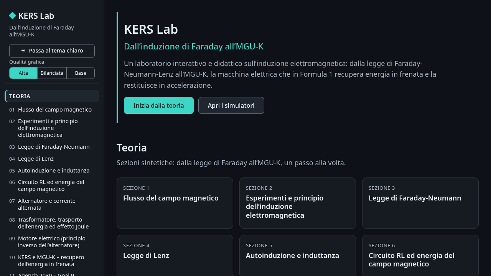
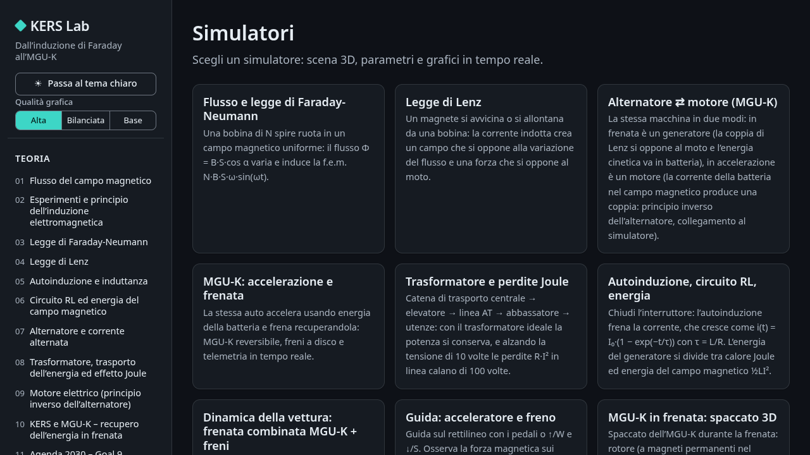
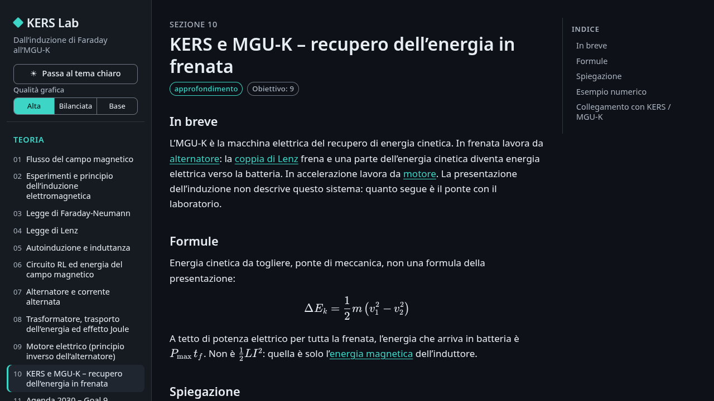
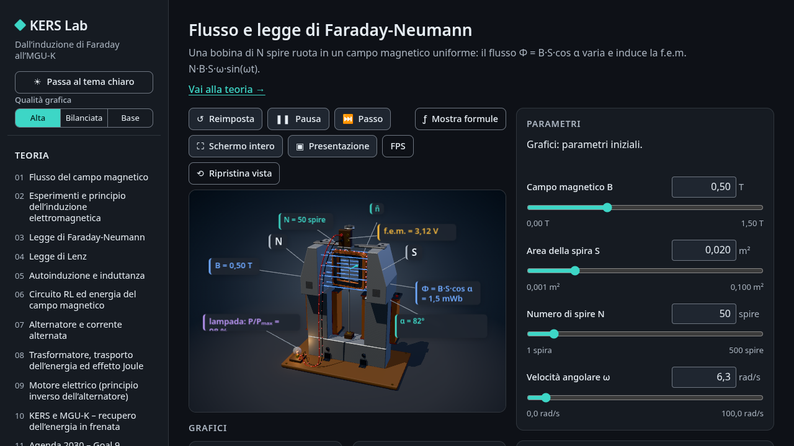
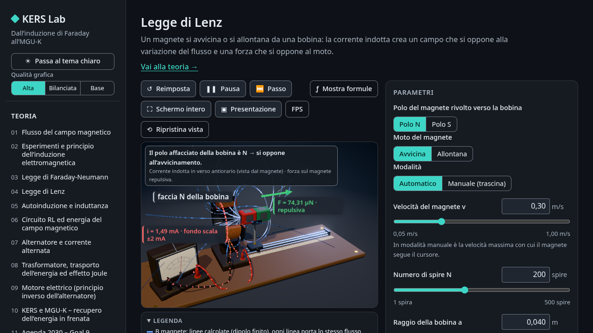
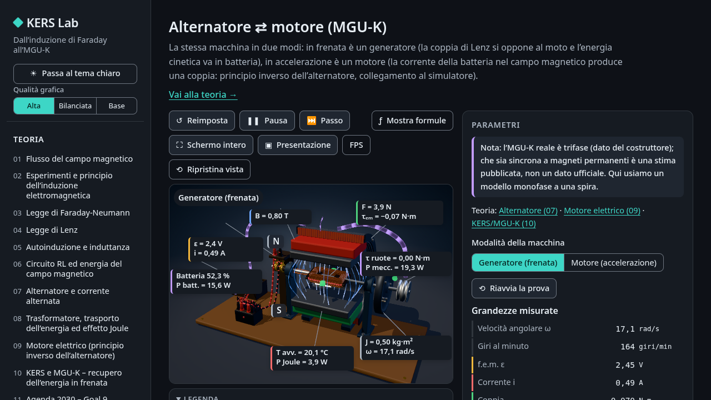
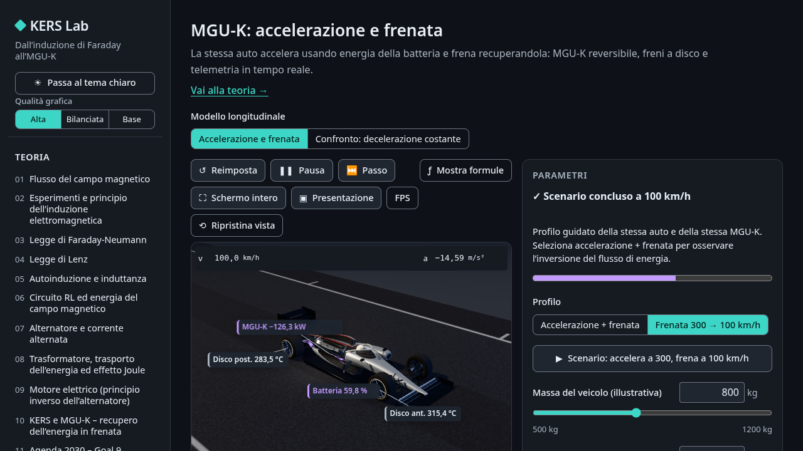
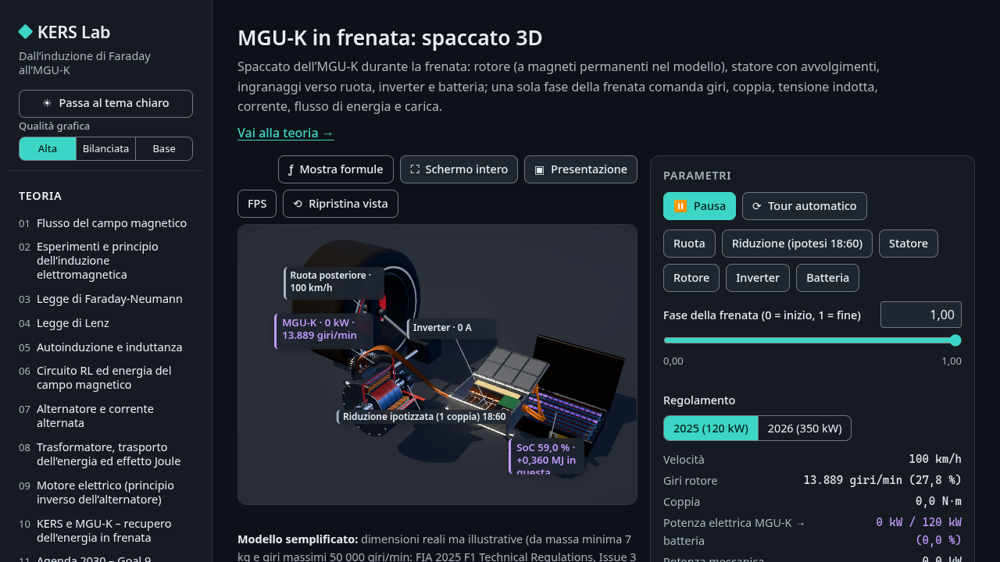
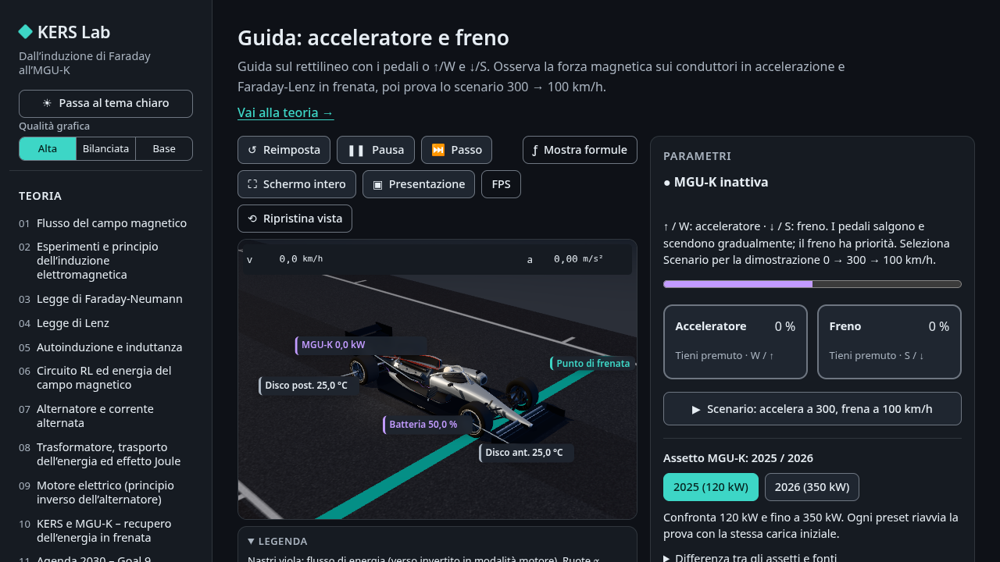
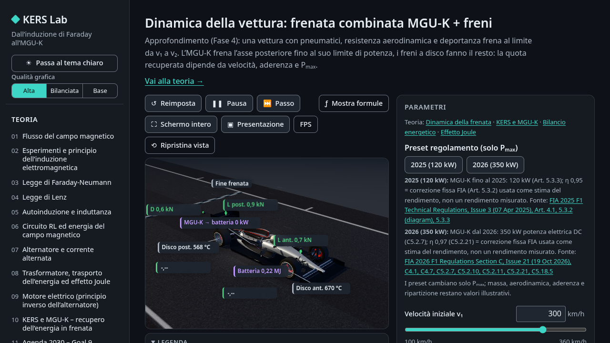

# KERS Lab

> **Dall'induzione di Faraday all'MGU-K**

[](https://github.com/Chip-jpg/MGUK-KERS-Simulator/actions/workflows/ci.yml)
[](https://github.com/Chip-jpg/MGUK-KERS-Simulator/actions/workflows/pages.yml)
[](./LICENSE)

**[Apri KERS Lab nel browser](https://chip-jpg.github.io/MGUK-KERS-Simulator/) — non occorre installare nulla.**

KERS Lab è un laboratorio didattico interattivo in italiano: attraverso 15 schede di teoria e 9 simulatori 3D, spiega come un campo magnetico può generare corrente e come l'MGU-K, la macchina elettrica della Formula 1, recupera energia durante la frenata e la restituisce in accelerazione. Formule, esempi e grafici che cambiano durante gli esperimenti aiutano a collegare la teoria a ciò che si osserva.

È disponibile anche un'app per Windows che funziona senza connessione a Internet.

## Il filo logico

Il laboratorio accompagna la presentazione di Chip: segue il percorso dalla fisica dell'induzione al recupero dell'energia, poi collega l'innovazione nella mobilità al Goal 9 dell'Agenda 2030 e al diritto alla salute dell'Art. 32 della Costituzione.

```
Induzione di Faraday-Neumann-Lenz
        │  una spira che ruota in un campo B genera una f.e.m.
        ▼
Alternatore ⇄ motore (principio inverso, forza magnetica sui conduttori percorsi da corrente)
        │  in frenata l'MGU-K fa da generatore, in accelerazione da motore
        ▼
MGU-K / KERS: recupero dell'energia cinetica, perdite per effetto Joule
        │  efficienza energetica e innovazione nella mobilità
        ▼
Agenda 2030 — Goal 9 (imprese, innovazione, infrastrutture) · cenni a Goal 7 e 13
        │  meno emissioni, ambiente più sano
        ▼
Art. 32 Costituzione — la salute come diritto individuale e interesse collettivo
```

## Teoria: le 15 schede

Le prime 14 schede formano il percorso principale; la scheda 15 è un approfondimento sulla frenata. Ogni scheda propone una spiegazione breve, formule, esempi numerici e collegamenti con l'MGU-K.

- **01** Flusso del campo magnetico
- **02** Esperimenti e principio dell’induzione elettromagnetica
- **03** Legge di Faraday-Neumann
- **04** Legge di Lenz
- **05** Autoinduzione e induttanza
- **06** Circuito RL ed energia del campo magnetico
- **07** Alternatore e corrente alternata
- **08** Trasformatore, trasporto dell’energia ed effetto Joule
- **09** Motore elettrico (principio inverso dell’alternatore)
- **10** KERS e MGU-K – recupero dell’energia in frenata
- **11** Agenda 2030 – Goal 9
- **12** Art. 32 della Costituzione – diritto alla salute
- **13** Il filo logico: da Faraday all’Art. 32
- **14** Glossario
- **15** Dinamica della frenata – MGU-K e freni insieme

## I 9 simulatori

Si possono cambiare i valori e osservare insieme la scena 3D, i grafici e le formule con i risultati numerici. Le letture restano accanto ai componenti; le legende spiegano le scale delle immagini.

| Simulatore                                                                    | Cosa mostra e quale principio illustra                                                                                                                                                                                                                                                                      |
| ----------------------------------------------------------------------------- | ----------------------------------------------------------------------------------------------------------------------------------------------------------------------------------------------------------------------------------------------------------------------------------------------------------- |
| **Flusso e legge di Faraday-Neumann**                                         | Una bobina ruota in un campo magnetico uniforme: il flusso cambia e nasce una tensione elettrica. Illustra la legge di Faraday-Neumann.                                                                                                                                                                     |
| **Legge di Lenz**                                                             | Un magnete si avvicina o si allontana da una bobina: la corrente indotta crea un campo che si oppone alla variazione. Illustra la legge di Lenz.                                                                                                                                                            |
| **Alternatore ⇄ motore (MGU-K)**                                              | La stessa macchina genera elettricità in frenata e produce movimento quando riceve corrente. Collega l'induzione alla forza magnetica sui conduttori percorsi da corrente e mostra i passaggi di energia.                                                                                                   |
| **MGU-K: accelerazione e frenata**                                            | L'auto accelera o frena, mentre la batteria si scarica o si ricarica; i grafici mostrano velocità, accelerazione, potenze e carica. Illustra la conservazione dell'energia con perdite e limiti di recupero, anche attraverso un confronto con il calcolo della frenata.                                    |
| **Trasformatore e perdite Joule**                                             | Un trasformatore ideale cambia tensione e corrente: a parità di potenza trasportata, una tensione 10 volte maggiore riduce le perdite di linea di 100 volte. Collega l'induzione all'effetto Joule.                                                                                                         |
| **Autoinduzione, circuito RL, energia**                                       | La corrente cresce gradualmente in un circuito con resistenza e bobina; il campo magnetico immagazzina energia. Illustra l'autoinduzione e il bilancio energetico.                                                                                                                                          |
| **Dinamica della vettura: frenata combinata MGU-K + freni** — approfondimento | Mostra come aderenza degli pneumatici, resistenza dell'aria e forza che preme l'auto al suolo influenzano la frenata. Collega le leggi del moto al recupero dell'energia: l'MGU-K agisce sulle ruote posteriori entro limiti di potenza e aderenza.                                                         |
| **Guida: acceleratore e freno** — dimostrazione finale                        | Permette di accelerare e frenare, osservando il bilancio dell'energia. L'esempio con massa di **800 kg**, da **300 → 100 km/h**, corrisponde a circa **2,47 MJ** di energia cinetica disponibile nella frenata. È un **modello 1D, non un simulatore di giro**: considera il moto lungo una sola direzione. |
| **MGU-K in frenata: spaccato 3D**                                             | Mostra la parte fissa (statore), quella rotante (rotore), il dispositivo che gestisce la corrente (inverter) e il percorso dell'energia. Collega l'induzione alla trasformazione dell'energia meccanica in energia elettrica.                                                                               |

**Comandi:** **F** apre lo schermo intero; **P** attiva la vista di presentazione. Nella guida si tengono premuti i pedali sullo schermo con mouse o tocco, oppure si usano **W / S** o **↑ / ↓**; i pulsanti rispondono anche a Spazio e Invio e l'azione cresce gradualmente. I preset **2025 (120 kW)** e **2026 (350 kW)** permettono di confrontare l'MGU-K con la stessa vettura e la stessa carica iniziale della batteria.

Nel menu laterale si può scegliere la **qualità grafica Alta, Bilanciata o Base**, secondo le capacità del computer.

## Screenshot



La pagina iniziale introduce il percorso di teoria.



L’indice raccoglie i simulatori disponibili.



La scheda 10 spiega il recupero dell’energia con KERS e MGU-K.



Una bobina ruota nel campo magnetico: flusso e tensione indotta.



Magnete e bobina mostrano il verso della corrente indotta.



La macchina elettrica funziona da alternatore o da motore.



L’MGU-K scambia energia con la batteria in accelerazione e frenata.



Lo spaccato 3D mostra i componenti dell’MGU-K e i flussi di energia.



La guida permette di provare acceleratore e freno.



La frenata combina l’azione dell’MGU-K e dei freni con i limiti di aderenza.

## Modello semplificato e crediti

KERS Lab è un **modello didattico, non un simulatore certificato**. Ogni simulatore dichiara le proprie semplificazioni: per esempio un campo uniforme, una sola spira al posto della macchina trifase reale, un trasformatore ideale o l'assenza di saturazione magnetica. Per l'MGU-K reale, la macchina trifase è un **dato del costruttore**; che sia sincrona a magneti permanenti è **una stima pubblicata, non un dato ufficiale**.

I valori citati provengono da fonti ufficiali oppure sono segnati **[DA VERIFICARE]**: i punti ancora aperti sono raccolti in [dati da verificare](docs/OPEN_FACTS.md). La corrispondenza tra formule e slide della presentazione è documentata in [formule e modelli fisici](docs/PHYSICS.md).

Il progetto non è affiliato a Formula 1, FIA o scuderie e non usa loghi, marchi o immagini protetti: la grafica è originale e costruita con forme geometriche. Le slide del corso non sono incluse.

Licenza [MIT](LICENSE) © 2026 Chip-jpg.

## Per chi sviluppa

I dettagli tecnici, i comandi e le procedure di pubblicazione sono nella [specifica tecnica e di build](docs/BUILD_SPEC.md).

## Roadmap

Le modifiche di ogni versione sono nel [CHANGELOG.md](CHANGELOG.md); i tag git e le pubblicazioni GitHub Release iniziano dalla v0.7.0, mentre le versioni precedenti sono documentate solo nel changelog.

- **v0.1.0 — Fasi 1–3:** struttura dell'app, modelli fisici, 14 schede di teoria, sei simulatori e modalità Interrogazione, poi rimossa nella v0.5.0.
- **v0.2.0 — Rifinitura:** correzioni dopo la revisione indipendente, accessibilità e guida alla pubblicazione del sito.
- **v0.3.x–v0.4.0 — Fase 4:** dinamica della vettura e app Windows; aggiunti anche i moduli sul campo di bobine reali e sul modello avanzato della macchina elettrica, poi rimossi nella v0.5.0.
- **v0.5.0 — Versione essenziale:** percorso concentrato su Faraday → MGU-K → Goal 9 → Art. 32; rimossi Interrogazione e quiz, riferimenti alle slide nell'interfaccia e i due moduli avanzati; conservata la dinamica della vettura.
- **v0.5.1 — Grafici più vicini alla scena:** disposizione di scena, grafici e comandi migliorata anche sugli schermi stretti.
- **v0.6.0 — Grafica 3D:** scene guidate dai modelli fisici, scale dichiarate e tre livelli di qualità grafica.
- **v0.7.0 — Guida e correzioni:** accelerazione e frenata nella stessa vettura, guida con pedali, batteria che può esaurirsi, misure in tempo reale, schermo intero e grafici migliorati.
- **v0.7.1 — Interfaccia:** letture accanto ai componenti, spaziature più chiare e pedali da tenere premuti.
- **v0.7.2 — Preset guida:** confronto tra l'MGU-K 2025 (120 kW) e 2026 (350 kW) nelle stesse condizioni iniziali.
- **v0.7.3 — Indicatori macchina:** letture ferme e leggibili accanto ai componenti dell'alternatore/motore.
- **v0.7.4 — Tipografia indicatori:** caratteri uniformi agli altri simulatori e testo più nitido.
- **v0.8.0 — Versione 3D (2026-11-05, ultimo tag e ultima release):** tutti i 9 simulatori ricostruiti in 3D nello stile dello spaccato, con selezione dei componenti e visita guidata automatica; pubblicazione alla radice del sito e in `/3d/`.

**Dopo la v0.8.0 (su main, non ancora in una release):**

- **PR #41 — Integrata il 2026-11-09:** leggibilità al proiettore e nuova pagina iniziale.
- **PR #42 e #43 — Integrate il 2026-11-12:** revisione finale della teoria allineata alla presentazione, glossario, formulazioni e adattamento agli schermi di telefono da 390 px.

**Ancora in revisione:**

- **PR #44 — Non ancora integrata:** indicatori su telefono, test, formulazione su macchina trifase e magneti permanenti, nuovo indirizzo della scheda 09 con reindirizzamento dal precedente.
- **Questa revisione del README:** italiano semplice, screenshot aggiornati e dettagli tecnici raccolti nella specifica di build.

**Da fare / aperto:**

- Pubblicare una nuova versione, con tag e release, che raccolga le modifiche successive alla v0.8.0.
- Verificare i dati ancora segnati **[DA VERIFICARE]** in [docs/OPEN_FACTS.md](docs/OPEN_FACTS.md).
- Esaminare gli aggiornamenti delle dipendenze proposti da Dependabot ancora aperti.
- Affrontare la firma dell'app Windows: attualmente non è firmata e mostra l'avviso SmartScreen.
