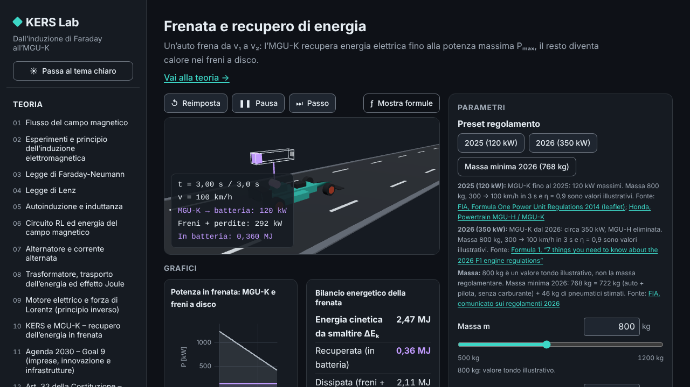
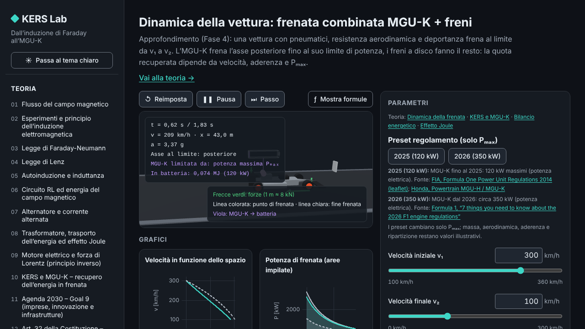

# KERS Lab

> **Dall'induzione di Faraday all'MGU-K**

[](https://github.com/Chip-jpg/MGUK-KERS-Simulator/actions/workflows/ci.yml)
[](https://github.com/Chip-jpg/MGUK-KERS-Simulator/actions/workflows/pages.yml)
[](./LICENSE)

**KERS Lab** è un laboratorio interattivo e didattico sull'induzione elettromagnetica:
parte dalla legge di Faraday-Neumann-Lenz e arriva all'**MGU-K**, la macchina elettrica
che in Formula 1 recupera energia in frenata e la restituisce in accelerazione.

È un'unica app web statica che funziona **offline** (nessuna richiesta di rete a
runtime, font inclusi), disponibile anche come app desktop per Windows, e contiene:

- **Teoria** — 15 schede sintetiche in italiano (14 del percorso principale + 1 di
  approfondimento sulla dinamica della frenata), con formule KaTeX, esempi numerici e
  collegamento con l'MGU-K.
- **Simulatori** — 7 simulatori 3D (6 di base + 1 di approfondimento) con grafici in
  tempo reale e formule che si aggiornano con i valori numerici.

**Versione attuale: v0.5.1** — tutte le fasi del progetto (1–4) sono completate; le
novità di ogni versione sono in [`CHANGELOG.md`](CHANGELOG.md).

## Il filo logico

```
Induzione di Faraday-Neumann-Lenz
        │  una spira che ruota in un campo B genera una f.e.m.
        ▼
Alternatore ⇄ motore (principio inverso, forza di Lorentz)
        │  in frenata l'MGU-K fa da generatore, in accelerazione da motore
        ▼
MGU-K / KERS: recupero dell'energia cinetica, perdite per effetto Joule
        │  efficienza energetica e innovazione nella mobilità
        ▼
Agenda 2030 — Goal 9 (imprese, innovazione, infrastrutture) · cenni a Goal 7 e 13
        │  meno emissioni, ambiente più sano
        ▼
Art. 32 Costituzione — la salute come diritto individuale e interesse collettivo
```

## Screenshot

| Teoria                                                                                               | Simulatore `faraday`                                                                                         |
| ---------------------------------------------------------------------------------------------------- | ------------------------------------------------------------------------------------------------------------ |
|                       |  |
| **Frenata e recupero di energia**                                                                    | **Dinamica della vettura**                                                                                   |
|  |            |

## I simulatori

| ID                  | Titolo                              | Cosa mostra                                                                                                |
| ------------------- | ----------------------------------- | ---------------------------------------------------------------------------------------------------------- |
| `faraday`           | Flusso e legge di Faraday-Neumann   | Spira di N spire che ruota in un campo uniforme; Φ(t) e f.e.m.(t), moto traslatorio (B·l·v).               |
| `lenz`              | Legge di Lenz                       | Magnete che si avvicina/allontana da una bobina: campo indotto, verso della corrente, forza che si oppone. |
| `alternator-motor`  | Alternatore ⇄ motore (MGU-K)        | La stessa macchina come generatore (frenata) e come motore (forza di Lorentz), con i flussi di energia.    |
| `kers-braking`      | Frenata e recupero di energia       | ΔE_k = ½m(v₁² − v₂²), energia recuperata limitata da Pₘₐₓ e η, resto dissipato nei freni.                  |
| `joule-transformer` | Trasformatore e perdite Joule       | Trasformatore ideale e perdite di linea: "10× tensione → 100× meno perdite".                               |
| `rl-energy`         | Autoinduzione, circuito RL, energia | i(t) = I₀(1 − e^(−t/τ)), τ = L/R, energia ½LI² e bilancio energetico.                                      |

**Approfondimento (Fase 4)**

| ID             | Titolo                                                  | Cosa mostra                                                                                                 |
| -------------- | ------------------------------------------------------- | ----------------------------------------------------------------------------------------------------------- |
| `car-dynamics` | Dinamica della vettura: frenata combinata MGU-K + freni | Pneumatici Pacejka, resistenza e deportanza, MGU-K sull'asse posteriore limitata da Pₘₐₓ/η e dall'aderenza. |

## Avvio rapido

Requisiti: **Node.js ≥ 20** (in CI si usa Node 22) e npm.

```bash
npm ci            # installa le dipendenze (versioni bloccate dal lockfile)
npm run dev       # server di sviluppo Vite → http://localhost:5173
npm run build     # build di produzione in dist/
npm run preview   # serve la build in locale
```

Controlli di qualità (gli stessi della CI):

```bash
npm run lint           # ESLint
npm run format:check   # Prettier
npm run typecheck      # TypeScript strict
npm test               # Vitest (unit test)
npm run test:coverage  # Vitest con copertura
npm run e2e            # Playwright (Chromium), smoke test end-to-end
```

Per Playwright con un Chromium già installato: `PW_CHROMIUM_PATH=/percorso/chrome npm run e2e`.

## Tecnologie

- **Vite 5 + TypeScript 5** (strict), senza framework UI: TypeScript "vanilla" e piccoli componenti.
- **Three.js r169** per le scene 3D, **uPlot 1.6** per i grafici in tempo reale.
- **marked 14 + KaTeX 0.16** per la teoria in Markdown con formule.
- **Vitest** (unit test) e **Playwright** (test end-to-end e accessibilità con axe su Chromium).
- **ESLint + Prettier**, Conventional Commits (commitlint), GitHub Actions, GitHub Pages.
- **Tauri 2** per l'app desktop Windows.

## Struttura del progetto

```
README.md  LICENSE  CHANGELOG.md  CONTRIBUTING.md
docs/            ARCHITECTURE.md, PHYSICS.md (formule ↔ slide), DECISIONS.md,
                 OPEN_FACTS.md (dati da verificare), QA_REPORT.md, DESKTOP.md, media/
content/theory/  NN-slug.md — schede di teoria (italiano)
src/
  core/          shell dell'app, router (hash), i18n (it.ts), tema, registro moduli
  physics/       TypeScript puro, unità SI, nessun DOM/Three.js
  ui/            componenti, slider, wrapper dei grafici
  sims/<id>/     un simulatore per cartella
  theory/        loader e renderer del Markdown
tests/  e2e/
.github/         workflow CI, deploy Pages, build desktop, modelli di issue e PR
src-tauri/       app desktop Windows (Tauri 2)
```

Dettagli in [`docs/ARCHITECTURE.md`](docs/ARCHITECTURE.md); decisioni in
[`docs/DECISIONS.md`](docs/DECISIONS.md).

## Roadmap

- [x] ✅ **v0.1.0 — Fasi 1–3** (completata): shell dell'app, motore fisico, teoria (14 schede), sei
      simulatori, modalità Interrogazione (rimossa nella v0.5.0).
- [x] ✅ **v0.2.0 — Rifinitura** (completata): correzioni dalla revisione indipendente,
      accessibilità, guida alla pubblicazione su GitHub Pages.
- [x] ✅ **v0.3.x–v0.4.0 — Fase 4 (avanzata, facoltativa)** (completata):
  1. ✅ `field-biot-savart` — linee di campo animate sulla GPU per bobine reali (Biot-Savart)
     (v0.3.0; rimosso nella v0.5.0);
  2. ✅ `pmsm-dq` — modello d-q della macchina sincrona a magneti permanenti, mappe
     coppia/potenza (v0.3.0; rimosso nella v0.5.0);
  3. ✅ `car-dynamics` (v0.3.1) — dinamica del veicolo (pneumatici Pacejka, aerodinamica, frenata combinata MGU-K + freni);
  4. ✅ app desktop Windows (`.exe`) con Tauri 2 (v0.4.0).

- [x] ✅ **v0.5.0 — Versione essenziale**: per scelta, l'app si concentra sul filo logico
      Faraday → MGU-K → Goal 9 → Art. 32. Rimossi la modalità Interrogazione (quiz,
      flashcard, ripasso), i riferimenti alle slide nell'interfaccia e i due moduli avanzati
      `field-biot-savart` e `pmsm-dq`; resta `car-dynamics`, che estende la frenata KERS
      ([D13](docs/DECISIONS.md)).

Le modifiche di ogni versione sono in [`CHANGELOG.md`](CHANGELOG.md).

## Come pubblicare una release

1. Una sola volta: in **Settings → Pages → Build and deployment → Source** scegli
   **GitHub Actions**.
2. Aggiorna `CHANGELOG.md` (sposta le voci di `[Unreleased]` in una nuova sezione
   `## [X.Y.Z] - AAAA-MM-GG`) e la versione in `package.json`, poi fai il merge su `main`.
3. Crea e pubblica il tag annotato: il push del tag `v*` avvia il workflow
   [`pages.yml`](.github/workflows/pages.yml), che compila e pubblica il sito su GitHub Pages.

   ```bash
   git tag -a vX.Y.Z -m "KERS Lab vX.Y.Z"
   git push origin vX.Y.Z
   ```

4. Crea la **GitHub Release** dal tag (`Releases → Draft a new release`, oppure
   `gh release create vX.Y.Z --title "vX.Y.Z" --notes-file note.md`), copiando come note
   il testo della sezione corrispondente di `CHANGELOG.md`.

## App desktop (Windows)

Lo stesso tag `v*` avvia anche [`desktop.yml`](.github/workflows/desktop.yml), che con
[Tauri 2](https://v2.tauri.app/) produce gli installer Windows (`.exe` NSIS e `.msi`) e li
allega alla Release del tag (se la Release non esiste ancora la crea: le note si
aggiornano poi con `gh release edit vX.Y.Z --notes-file note.md`). L’app usa la stessa
build del sito ed è completamente offline. Build locale su Windows: `npm run desktop:build`.
Prerequisiti, CSP e limitazioni (binario non firmato → avviso SmartScreen, nessun
aggiornamento automatico) in [`docs/DESKTOP.md`](docs/DESKTOP.md).

## Modello semplificato

KERS Lab è un **modello didattico**, non un simulatore certificato: ogni simulatore
dichiara le proprie ipotesi in una nota "Modello semplificato: …" (campo uniforme,
spira singola al posto della reale macchina trifase, generalmente descritta come
sincrona a magneti permanenti `[DA VERIFICARE]`,
trasformatore ideale, niente saturazione…). I valori regolamentari citati provengono
da fonti ufficiali oppure sono marcati `[DA VERIFICARE]`.

Il progetto **non è affiliato** a Formula 1, FIA o a qualsiasi scuderia e non usa loghi,
marchi o immagini protetti: tutta la grafica è geometria astratta originale. Le slide
del corso non sono incluse.

## Contribuire

Leggi [`CONTRIBUTING.md`](CONTRIBUTING.md): un branch per task, Conventional Commits,
test obbligatori, fisica "pura", testi in italiano e codice in inglese.

## Licenza

[MIT](./LICENSE) © 2026 Chip-jpg

---

## English summary

**KERS Lab** — _from Faraday's induction to the MGU-K_ — is an educational, offline-first
web app (Italian UI) that walks from the Faraday-Neumann-Lenz law to the Formula 1
MGU-K (kinetic energy recovery). It bundles 15 concise theory pages and seven
interactive 3D simulators with live plots and formulas (including an advanced module on
braking vehicle dynamics: tyres, aerodynamics and the MGU-K on the rear axle). Since
v0.5.0 the app is deliberately slim: no quiz mode, no slide references in the UI and no
Biot-Savart / PMSM modules. A Windows desktop build
(Tauri 2) is produced by CI on every release tag. The narrative links electromagnetic induction → the MGU-K → UN Agenda 2030
Goal 9 → Article 32 of the Italian Constitution (health as a right and a collective
interest).

Built with Vite 5, TypeScript 5 (strict), Three.js, uPlot, marked + KaTeX; tested with
Vitest and Playwright. Run it with `npm ci && npm run dev`. It is a simplified
educational model, not a certified simulator, and is not affiliated with Formula 1,
the FIA or any team. Licensed under MIT.
