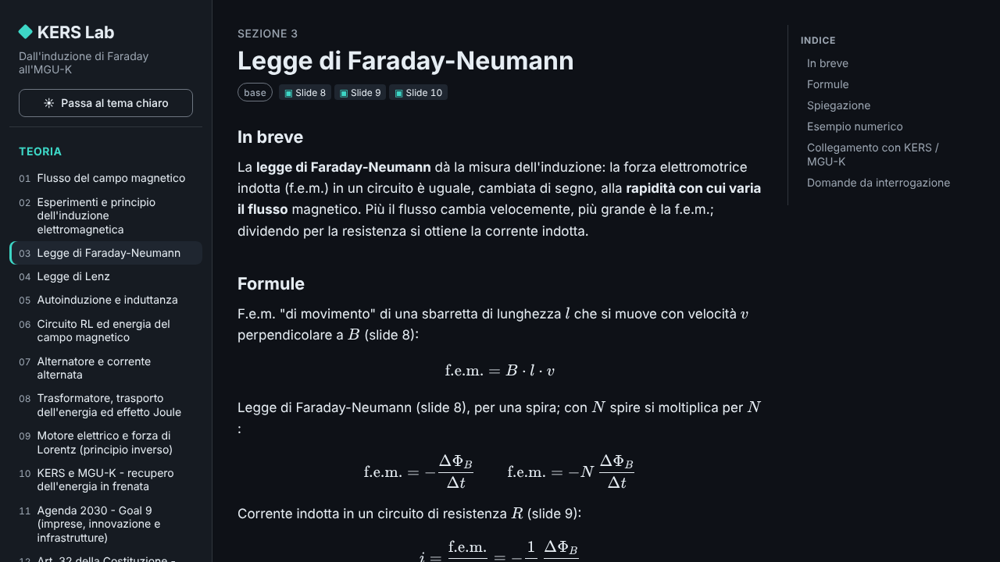
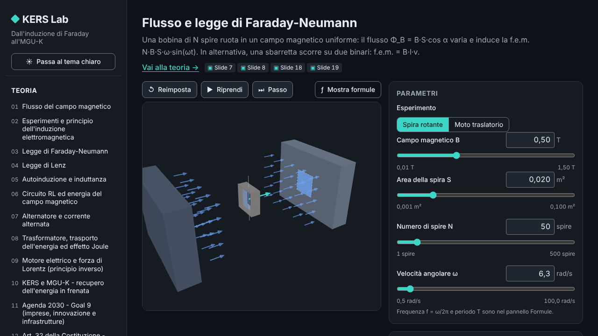

# KERS Lab

> **Dall'induzione di Faraday all'MGU-K**

[](https://github.com/Chip-jpg/MGUK-KERS-Simulator/actions/workflows/ci.yml)
[](https://github.com/Chip-jpg/MGUK-KERS-Simulator/actions/workflows/pages.yml)
[](./LICENSE)

**KERS Lab** è un laboratorio interattivo e didattico sull'induzione elettromagnetica:
parte dalla legge di Faraday-Neumann-Lenz e arriva all'**MGU-K**, la macchina elettrica
che in Formula 1 recupera energia in frenata e la restituisce in accelerazione.

È un'unica app web statica che funziona **offline** (nessuna richiesta di rete a
runtime, font inclusi) e contiene:

- **Teoria** — 14 schede in italiano, sintetiche e pensate per l'interrogazione, con
  formule KaTeX e riferimenti alle slide del corso.
- **Simulatori** — 6 simulatori 3D con grafici in tempo reale e formule che si
  aggiornano con i valori numerici.
- **Interrogazione** — quiz e flashcard ("spiega a voce") con domande numeriche
  generate dal motore fisico e ripasso degli errori.

## Il filo logico

```
Induzione di Faraday-Neumann-Lenz
        │  una spira che ruota in un campo B genera una f.e.m.
        ▼
Alternatore ⇄ motore (principio inverso, forza di Lorentz)
        │  in frenata l'MGU-K fa da generatore, in accelerazione da motore
        ▼
MGU-K / KERS: recupero dell'energia cinetica, perdite per effetto Joule
        │  efficienza energetica e innovazione nella mobilità
        ▼
Agenda 2030 — Goal 9 (imprese, innovazione, infrastrutture) · cenni a Goal 7 e 13
        │  meno emissioni, ambiente più sano
        ▼
Art. 32 Costituzione — la salute come diritto individuale e interesse collettivo
```

## Screenshot

> Catture generate dai test end-to-end (`e2e/screenshots/`). Altre immagini
> (frenata `kers-braking`, Interrogazione, animazione generatore ⇄ motore): screenshot in arrivo.

| Teoria                                                                          | Simulatore `faraday`                                                                                                     |
| ------------------------------------------------------------------------------- | ------------------------------------------------------------------------------------------------------------------------ |
|  |  |

## I simulatori

| ID                  | Titolo                              | Cosa mostra                                                                                                |
| ------------------- | ----------------------------------- | ---------------------------------------------------------------------------------------------------------- |
| `faraday`           | Flusso e legge di Faraday-Neumann   | Spira di N spire che ruota in un campo uniforme; Φ(t) e f.e.m.(t), moto traslatorio (B·l·v).               |
| `lenz`              | Legge di Lenz                       | Magnete che si avvicina/allontana da una bobina: campo indotto, verso della corrente, forza che si oppone. |
| `alternator-motor`  | Alternatore ⇄ motore (MGU-K)        | La stessa macchina come generatore (frenata) e come motore (forza di Lorentz), con i flussi di energia.    |
| `kers-braking`      | Frenata e recupero di energia       | ΔE_k = ½m(v₁² − v₂²), energia recuperata limitata da P_max e η, resto dissipato nei freni.                 |
| `joule-transformer` | Trasformatore e perdite Joule       | Trasformatore ideale e perdite di linea: "10× tensione → 100× meno perdite".                               |
| `rl-energy`         | Autoinduzione, circuito RL, energia | i(t) = I₀(1 − e^(−t/τ)), τ = L/R, energia ½LI² e bilancio energetico.                                      |

## Avvio rapido

Requisiti: **Node.js ≥ 20** (in CI si usa Node 22) e npm.

```bash
npm ci            # installa le dipendenze (versioni bloccate dal lockfile)
npm run dev       # server di sviluppo Vite → http://localhost:5173
npm run build     # build di produzione in dist/
npm run preview   # serve la build in locale
```

Controlli di qualità (gli stessi della CI):

```bash
npm run lint           # ESLint
npm run format:check   # Prettier
npm run typecheck      # TypeScript strict
npm test               # Vitest (unit test)
npm run test:coverage  # Vitest con copertura
npm run e2e            # Playwright (Chromium), smoke test end-to-end
```

Per Playwright con un Chromium già installato: `PW_CHROMIUM_PATH=/percorso/chrome npm run e2e`.

## Tecnologie

- **Vite 5 + TypeScript 5** (strict), senza framework UI: TypeScript "vanilla" e piccoli componenti.
- **Three.js r169** per le scene 3D, **uPlot 1.6** per i grafici in tempo reale.
- **marked 14 + KaTeX 0.16** per la teoria in Markdown con formule.
- **Vitest** (unit test) e **Playwright** (smoke test su Chromium).
- **ESLint + Prettier**, Conventional Commits (commitlint), GitHub Actions, GitHub Pages.

## Struttura del progetto

```
README.md  LICENSE  CHANGELOG.md  CONTRIBUTING.md
docs/            ARCHITECTURE.md, PHYSICS.md (formule ↔ slide), DECISIONS.md
content/theory/  NN-slug.md — schede di teoria (italiano)
content/quiz/    quiz.json
src/
  core/          shell dell'app, router (hash), i18n (it.ts), tema, registro moduli
  physics/       TypeScript puro, unità SI, nessun DOM/Three.js
  ui/            componenti, slider, wrapper dei grafici
  sims/<id>/     un simulatore per cartella
  theory/        loader e renderer del Markdown
  quiz/          modalità Interrogazione
tests/  e2e/
.github/         workflow CI, deploy Pages, modelli di issue e PR
```

Dettagli in [`docs/ARCHITECTURE.md`](docs/ARCHITECTURE.md); decisioni in
[`docs/DECISIONS.md`](docs/DECISIONS.md).

## Roadmap

- [x] ✅ **v0.1.0 — Fasi 1–3** (completata): shell dell'app, motore fisico, teoria (14 schede), sei
      simulatori, modalità Interrogazione.
- [ ] **v0.2.0 — Rifinitura**: correzioni dalla revisione indipendente, accessibilità,
      prestazioni, sito pubblicato su GitHub Pages.
- [ ] **v0.3.x — Fase 4 (avanzata, facoltativa)**, un modulo per release:
  1. `field-biot-savart` — linee di campo animate sulla GPU per bobine reali (Biot-Savart);
  2. `pmsm-dq` — modello d-q della macchina sincrona a magneti permanenti, mappe coppia/potenza;
  3. `car-dynamics` — dinamica del veicolo (pneumatici Pacejka, aerodinamica, frenata combinata MGU-K + freni);
  4. app desktop Windows (`.exe`) con Tauri 2.

Le modifiche di ogni versione sono in [`CHANGELOG.md`](CHANGELOG.md).

## Modello semplificato

KERS Lab è un **modello didattico**, non un simulatore certificato: ogni simulatore
dichiara le proprie ipotesi in una nota "Modello semplificato: …" (campo uniforme,
spira singola al posto della reale macchina trifase, generalmente descritta come
sincrona a magneti permanenti `[DA VERIFICARE]`,
trasformatore ideale, niente saturazione…). I valori regolamentari citati provengono
da fonti ufficiali oppure sono marcati `[DA VERIFICARE]`.

Il progetto **non è affiliato** a Formula 1, FIA o a qualsiasi scuderia e non usa loghi,
marchi o immagini protetti: tutta la grafica è geometria astratta originale. Le slide
del corso sono citate solo per numero, non incluse.

## Contribuire

Leggi [`CONTRIBUTING.md`](CONTRIBUTING.md): un branch per task, Conventional Commits,
test obbligatori, fisica "pura", testi in italiano e codice in inglese.

## Licenza

[MIT](./LICENSE) © 2026 Chip-jpg

---

## English summary

**KERS Lab** — _from Faraday's induction to the MGU-K_ — is an educational, offline-first
web app (Italian UI) that walks from the Faraday-Neumann-Lenz law to the Formula 1
MGU-K (kinetic energy recovery). It bundles concise exam-oriented theory pages,
six interactive 3D simulators with live plots and formulas, and a quiz / oral-exam
trainer. The narrative links electromagnetic induction → the MGU-K → UN Agenda 2030
Goal 9 → Article 32 of the Italian Constitution (health as a right and a collective
interest).

Built with Vite 5, TypeScript 5 (strict), Three.js, uPlot, marked + KaTeX; tested with
Vitest and Playwright. Run it with `npm ci && npm run dev`. It is a simplified
educational model, not a certified simulator, and is not affiliated with Formula 1,
the FIA or any team. Licensed under MIT.
